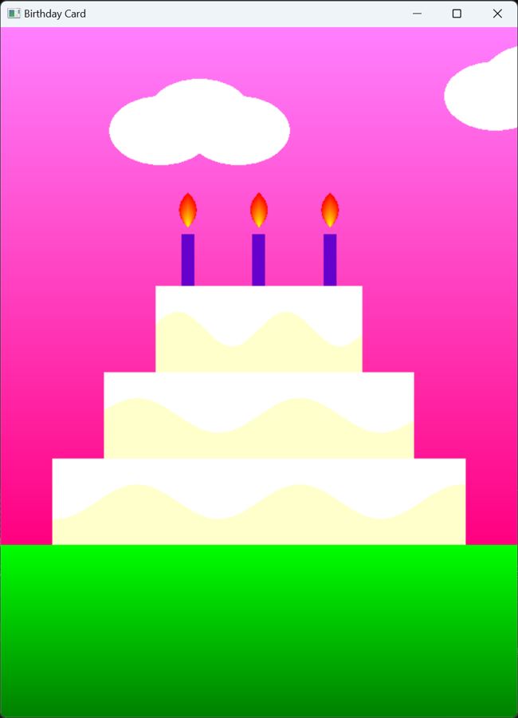
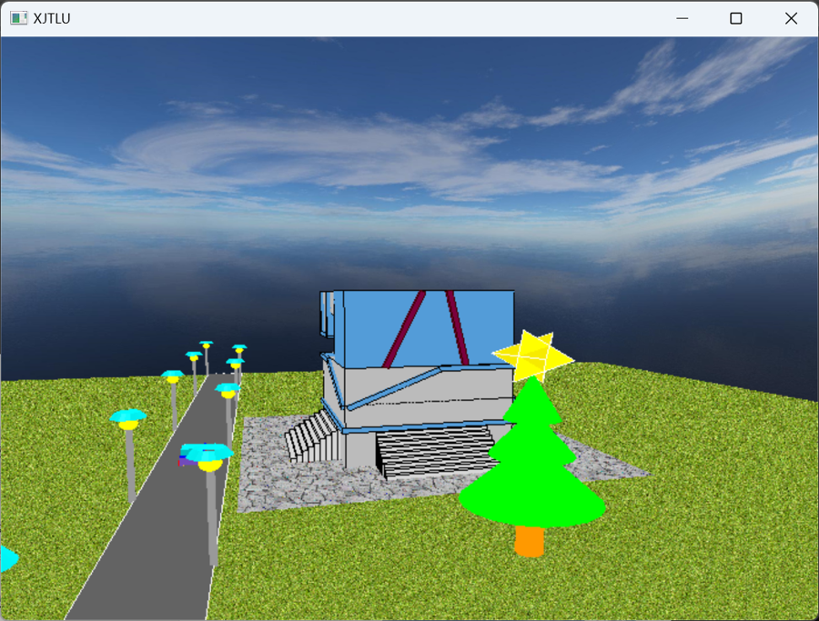

# Interactive Graphics in C++ and OpenGL

Two scenes by Zeyu Cheng for CPT205 at Xi'an Jiaotong-Liverpool University. In the birthday card, a click scatters a spinning star over the cake. In the campus scene, orbit the central building as a car travels along the road.

| [2D birthday card](projects/birthday-card/main.cpp) | [3D campus scene](projects/campus-scene/main.cpp) |
| --- | --- |
|  |  |

## Inside the scenes

**Birthday card.** Cubic Bézier curves shape the candle flames. A freeglut timer animates the clouds, shrinking flames and rotating stars. Press **e** to blow out the candles, **b** to relight them and **f** to release a balloon and reveal the letter. Click with the left or right mouse button to place a small or large star.

**XJTLU campus.** The central building, streetlights and car use OpenGL primitives and local transformations. Eight BMP textures cover the ground and the six faces of the skybox. Press **a / d** to orbit, **w / s** to move closer or farther away, and lowercase **l** to switch light sources.

## Build on Windows

Open an **MSYS2 UCRT64** shell and install the compiler, build tools and freeglut:

```sh
pacman -S --needed mingw-w64-ucrt-x86_64-{gcc,cmake,ninja,freeglut}
```

From the root of this repository, build both scenes and launch either one:

```sh
cmake -S . -B build -G Ninja
cmake --build build
cd build
./birthday-card.exe
# Close the card window before starting the campus scene.
./campus-scene.exe
```

The campus scene reads its textures relative to the working directory. CMake copies the texture folder beside the executable, so start it from the build directory shown above.

## Build on Ubuntu

Install the dependencies, then run the commands below from the repository root:

```sh
sudo apt install build-essential cmake ninja-build freeglut3-dev libglu1-mesa-dev
cmake -S . -B build -G Ninja
cmake --build build
cd build
./birthday-card
./campus-scene
```

Both programs use desktop OpenGL's fixed-function pipeline and need a graphical display.
